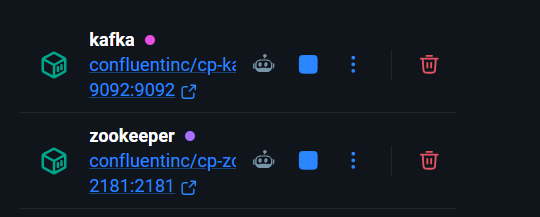
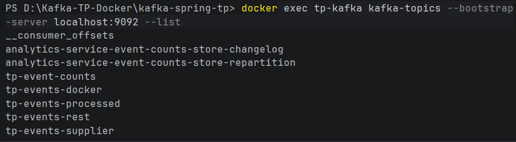
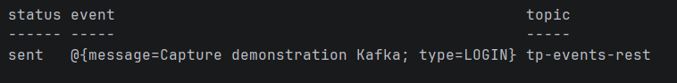
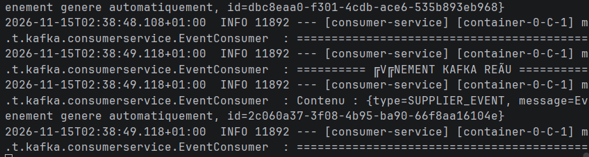
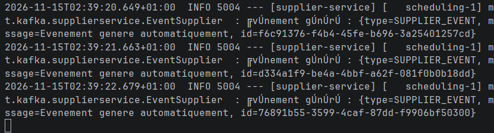
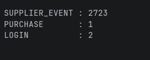
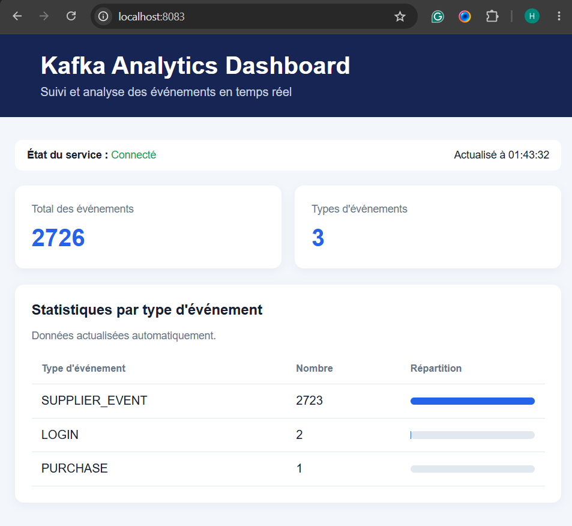

# Kafka Event-Driven Microservices with Spring Cloud Stream

A practical event-driven architecture built with **Apache Kafka**, **Spring Boot**, and **Spring Cloud Stream**. This project demonstrates asynchronous communication between independent microservices, automatic event generation, real-time stream processing, and event analytics through a REST API and a web dashboard.

---

## Project Overview

The objective of this project is to implement an event-driven system using Apache Kafka as a distributed messaging platform.

The application consists of four independent Spring Boot services:

1. **Producer Service:** Exposes a REST API to publish events to Kafka.
2. **Consumer Service:** Subscribes to Kafka topics and processes incoming events.
3. **Supplier Service:** Automatically generates and publishes events.
4. **Analytics Service:** Processes event streams, calculates event counts by type, and exposes the results through a REST API and a web dashboard.

The services communicate asynchronously through Kafka topics, reducing direct dependencies between application components.

## Architecture

The application follows an event-driven microservices architecture.

```text
                   REST Client
                       |
                       v
              +------------------+
              | Producer Service |
              |    Port 8081     |
              +------------------+
                       |
                       v
                 tp-events-rest
                       |
                       |
              +------------------+
              | Consumer Service|
              |    Port 8082    |
              +------------------+


              +------------------+
              | Supplier Service |
              | Automatic Events |
              +------------------+
                       |
                       v
               tp-events-supplier


       tp-events-rest + tp-events-supplier
                       |
                       v
              +------------------+
              | Analytics Service|
              |   Kafka Streams  |
              |    Port 8083     |
              +------------------+
                       |
                       v
                tp-event-counts
                       |
                       v
              +------------------+
              | Analytics REST   |
              |    API           |
              +------------------+
                       |
                       v
                Web Dashboard
```

**Infrastructure:** Apache Kafka and ZooKeeper run in Docker containers.

## Technologies

| Technology | Purpose |
|---|---|
| Java 17 | Programming language |
| Spring Boot | Microservices framework |
| Spring Cloud Stream | Kafka messaging integration |
| Apache Kafka | Distributed event streaming |
| Kafka Streams | Real-time event processing |
| Spring Kafka | Kafka integration and listeners |
| Maven | Dependency and build management |
| Docker | Containerized infrastructure |
| ZooKeeper | Kafka coordination |
| HTML, CSS, JavaScript | Analytics dashboard |
| Git and GitHub | Version control and source hosting |

## Project Structure

```text
kafka-spring-tp/
│
├── producer-service/
│   └── src/main/
│       ├── java/
│       │   └── ma/tp/kafka/producer_service/
│       │       ├── EventController.java
│       │       └── ProducerServiceApplication.java
│       └── resources/
│           └── application.properties
│
├── consumer-service/
│   └── src/main/
│       ├── java/
│       │   └── ma/tp/kafka/consumerservice/
│       │       ├── EventConsumer.java
│       │       └── ConsumerServiceApplication.java
│       └── resources/
│           └── application.properties
│
├── supplier-service/
│   └── src/main/
│       ├── java/
│       │   └── ma/tp/kafka/supplierservice/
│       │       ├── EventSupplier.java
│       │       └── SupplierServiceApplication.java
│       └── resources/
│           └── application.properties
│
├── analytics-service/
│   └── src/main/
│       ├── java/
│       │   └── ma/tp/kafka/analyticsservice/
│       │       ├── AnalyticsProcessor.java
│       │       ├── AnalyticsController.java
│       │       └── AnalyticsServiceApplication.java
│       └── resources/
│           ├── application.properties
│           └── static/
│               └── index.html
│
├── screenshots/
│   ├── 01-docker-containers.png
│   ├── 02-kafka-topics.png
│   ├── 05-producer-rest.png
│   ├── 06-consumer-logs.png
│   ├── 07-supplier-logs.png
│   ├── 08-analytics-api.png
│   └── 09-dashboard.png
│
├── .gitignore
└── README.md
```

## Prerequisites

Make sure the following tools are installed:

- Java Development Kit (JDK) 17
- Apache Maven
- Docker Desktop
- Git
- IntelliJ IDEA or another Java IDE
- Postman or PowerShell for REST API testing

Check the Java and Maven versions:

```bash
java -version
mvn -version
```

## Kafka Infrastructure with Docker

Kafka and ZooKeeper are deployed locally using Docker Compose.

Start the containers from the directory containing `docker-compose.yml`:

```bash
docker compose up -d
```

Check the running containers:

```bash
docker ps
```

The expected containers are:

- `tp-zookeeper`
- `tp-kafka`

List the available Kafka topics:

```bash
docker exec tp-kafka kafka-topics --bootstrap-server localhost:9092 --list
```

### Create Kafka Topics

The project uses the following topics:

```bash
docker exec tp-kafka kafka-topics --bootstrap-server localhost:9092 --create --if-not-exists --topic tp-events-rest --partitions 1 --replication-factor 1

docker exec tp-kafka kafka-topics --bootstrap-server localhost:9092 --create --if-not-exists --topic tp-events-supplier --partitions 1 --replication-factor 1

docker exec tp-kafka kafka-topics --bootstrap-server localhost:9092 --create --if-not-exists --topic tp-event-counts --partitions 1 --replication-factor 1
```

The project also retains `tp-events-docker` for the initial Docker-based Kafka tests.

## Microservices

### 1. Producer Service

**Port:** `8081`

The Producer Service exposes a REST endpoint that receives JSON events and publishes them to Kafka using Spring Cloud Stream and `StreamBridge`.

**Endpoint:**

```http
POST http://localhost:8081/api/events
```

**Example request:**

```json
{
  "type": "LOGIN",
  "message": "User connected successfully"
}
```

The event is published to the `tp-events-rest` topic.

### 2. Consumer Service

The Consumer Service listens to Kafka events and processes incoming messages asynchronously.

It demonstrates how an independent service can subscribe to Kafka topics without requiring direct communication with the Producer Service.

### 3. Supplier Service

The Supplier Service automatically generates events using a Spring Cloud Stream Supplier function.

Example event:

```json
{
  "id": "generated-uuid",
  "type": "SUPPLIER_EVENT",
  "message": "Evenement genere automatiquement"
}
```

Generated events are published to:

```text
tp-events-supplier
```

### 4. Analytics Service

**Port:** `8083`

The Analytics Service uses Kafka Streams to process events from:

- `tp-events-rest`
- `tp-events-supplier`

The processing pipeline:

1. Reads events from Kafka topics.
2. Extracts the event type from each JSON message.
3. Groups events by type.
4. Calculates the number of events for each type.
5. Publishes updated counts to `tp-event-counts`.

The service also exposes a REST API to retrieve the analytics results.

## Kafka Topics

| Topic | Description |
|---|---|
| `tp-events-rest` | Events published through the REST Producer |
| `tp-events-supplier` | Automatically generated events |
| `tp-event-counts` | Aggregated event counts |
| `tp-events-docker` | Topic used for initial Kafka Docker tests |
| `tp-events-processed` | Topic used during the initial stream-processing test |

## Running the Project

Start the infrastructure first:

```bash
docker compose up -d
```

Then start each Spring Boot service in a separate terminal.

**Terminal 1 — Producer**

```bash
cd producer-service
mvn spring-boot:run
```

**Terminal 2 — Consumer**

```bash
cd consumer-service
mvn spring-boot:run
```

**Terminal 3 — Supplier**

```bash
cd supplier-service
mvn spring-boot:run
```

**Terminal 4 — Analytics**

```bash
cd analytics-service
mvn spring-boot:run
```

Make sure Kafka is running before starting the services.

## API Endpoints

### Publish an Event

```http
POST http://localhost:8081/api/events
Content-Type: application/json
```

### Retrieve Analytics

```http
GET http://localhost:8083/api/analytics
```

Actual values depend on the events processed during execution.

## Analytics Dashboard

The Analytics Service includes a web dashboard implemented with HTML, CSS, and JavaScript.

Open the following URL after starting the Analytics Service:

```text
http://localhost:8083/
```

The dashboard retrieves statistics from the `/api/analytics` endpoint and displays event counts by type.

## Screenshots

The following screenshots document the implementation and execution of the project.

### Docker Infrastructure



### Kafka Topics



### Producer REST API



### Consumer Service



### Supplier Service



### Analytics REST API



### Analytics Dashboard




## Conclusion

This project demonstrates the implementation of an event-driven microservices architecture using Apache Kafka and Spring technologies.

It covers asynchronous event publishing and consumption, automatic event generation, stream processing, aggregation, and analytics visualization.

The project provides practical experience with distributed messaging, Kafka integration, and the development of independent Spring Boot services.